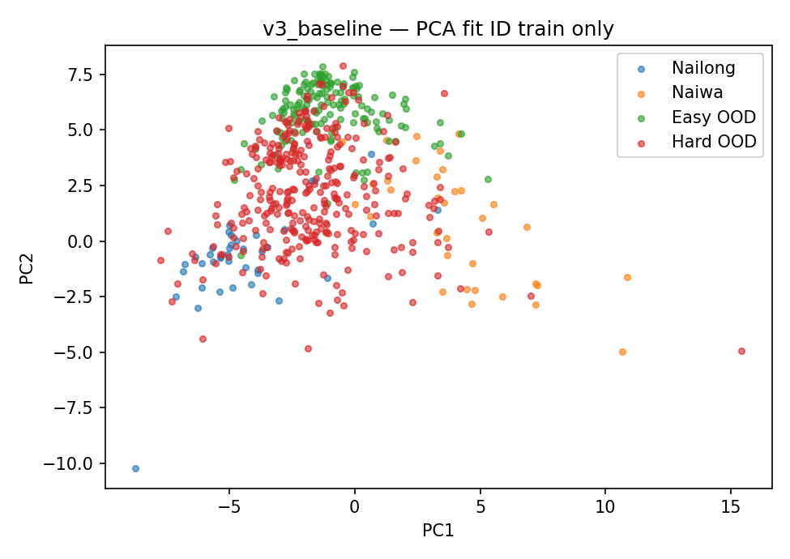
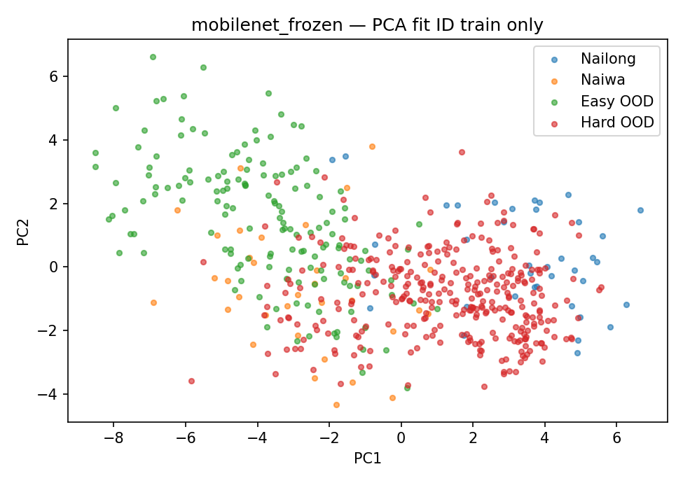

# V4 Phase 1：固定 Hard-OOD 与预训练 CNN 对照

**结论 C：本轮 MobileNet 系统的 Hard-OOD 拒识更差，保留 V3。下一阶段优先 Hard Negative Mining / 有针对性的负样本曝光，不继续堆 backbone。本轮未使用 SupCon、Triplet、ViT、CLIP 或 ensemble。**

这份结果只针对下述固定基准与 seed42 协议。它不支持“换 ImageNet backbone 就基本解决 Near-OOD”的假设，但也不能证明预训练特征本身更差：特征距离的排序指标确实有提高，Energy 与校准 operating point 没有转化为更低 Hard FAR。

生产 `web/` 的全部17个文件、V3 checkpoint 的 SHA-256 在实验前后保持一致；没有替换线上模型，也没有重做 UI。实验候选仅保存于 `artifacts/v4/`。V3 冻结记录在 `results/v3_baseline/`，原 `results/v3/` 未覆盖。

## 固定 benchmark 与隔离范围

新基准 **321 张，121 个 Unicode 图标身份组**：138 张黄色/夸张卡通表情、122 张卡通动物/生物、61 张可爱人形/幻想角色。来源 Noto121、Twemoji121、Fluent UI 3D79。它们是公开发布的真实绘制/渲染图片，不是随机噪声或 AI 生成图。

**121组不等同于121个独立商业角色或画风。** 本轮能稳定取得的是卡通/3D emoji 图形，未建立覆盖真实毛绒玩具照片、广泛商业卡通、二创截图的 benchmark；没有为了凑数塞进汽车、建筑、风景。相同来源画风和相近基础表情变体仍可能存在。

- 排除 V3 所有 Hard train/val/test 的 Unicode 身份，共131个旧组；旧149张 Hard test 没有混入。
- 与原始 ID/Easy train/val/test、V3 Hard 全部图片、用户反馈文件做 RGB 像素哈希比对，新集跨项目精确重复为0；自身重复为0。
- 构建后、模型评分前做一次语义审查，剔除29张植物、木头、羽毛、巢等非角色候选。未依据模型分数选图。
- 所有321张均标记 test_only、used_for_training=false、used_for_validation=false，绝不用于 OE、阈值、epoch、学习率或模型候选选择。
- 原始 ID test73、Easy test150 保持原划分；每个模型的测试路径/标签/文件 SHA 顺序完全相同，共544张。
- 原始73张 ID validation、150张 Easy validation、V3旧70张 Hard validation 只用于校准。这70张与新321张在身份和像素上隔离。
- 现有 `data/hard_negative/`、`data/false_positive/` loader 增加永久 benchmark 像素保护，误放新 test 图片会阻止训练，已实际验证。不要把本报告的测试错误复制进训练。

`data/hard_ood_test_manifest.json` 和 `results/v4_phase1/hard_ood_test_manifest.json` 固定每张 URL、源版本、标签、身份、用途、文件/像素哈希。文件丢失时自动按已发布 manifest 精确恢复；下载失败/源文件变化会报错，不能静默缩小样本数。本次已实际移走一张图片后从公开源恢复，manifest 和文件哈希保持不变。

来源和署名：

- Google [Noto Emoji v2.047](https://github.com/googlefonts/noto-emoji/tree/v2.047)，Apache-2.0。
- Twitter / jdecked [Twemoji](https://github.com/jdecked/twemoji/tree/7407fa31c51be5ab45626b8ab5554d50cc8073f6)，固定 commit7407fa31，图形 CC BY4.0。
- Microsoft [Fluent UI Emoji](https://github.com/microsoft/fluentui-emoji/tree/1ffb34c752ecf5d402f04cfb4b392c77f57c54bc)，固定 commit1ffb34c7，MIT，3D样式。

PNG不提交到本项目；许可文本随下载保存在 `data/hard_ood_benchmark/`。无法审计官方 ImageNet 预训练语料的逐图重叠，不声称对预训练语料也作过文件级去重。

## 预注册与公平性

`experiments/v4_phase1/protocol.json` 在新集评分/训练前保存，`data_lock.json` 固定 train/val/test 和 benchmark 哈希。

V3 固定原网络与部署 detector：四层 Conv32/64/128/256、GAP256、两类 head，128输入，无 normalization；raw embedding、shared LedoitWolf、Energy T5、OR，原阈值不变。

MobileNet 通过官方 torchvision `MobileNet_V3_Small_Weights.IMAGENET1K_V1` 加载，原官方权重 URL为 https://download.pytorch.org/models/mobilenet_v3_small-047dcff4.pth 。源文件完整SHA保存在各 training_config。去掉1000类 head，576D pooled feature → Linear128 → Dropout0.2 → Linear2。128D projection 用 ID train PCA 初始化，之后真实参与 CE 训练。输出 raw logits 和 pre-dropout embedding；ImageNet mean/std 在网络内部，外部输入仍是 RGB float32 0–1。

主实验 MobileNet224，同时预注册 Frozen128 同分辨率对照。使用相同345张 ID train、相同73张 ID val；不让新 MobileNet 接触任何 OE/OOD 训练图。相同基础增强：水平翻转、±8°旋转、轻度 ColorJitter；验证/测试只做确定性 resize。Frozen 缓存原图+4个固定增强视图的 backbone 特征，再训练 projection/head；PartialFT 每epoch动态增强。两者唯一图片集合仍为同一345张。

**因果限制必须保留：V3 历史上接受过600 Easy+143 Hard OE，而新 MobileNet 按本轮范围只用 ID CE；主实验还改变了128→224分辨率。Frozen128控制了尺寸，却未消除历史训练目标、增强视图次数、维度和投影方式的差异。因此这是“当前V3系统 vs 指定预训练CNN方案”的严格固定测试比较，不是所有因素完全匹配、只改变backbone的因果实验。**

Frozen：全 backbone和BN冻结/eval，训练128D projection与head，AdamW projection lr1e-4、head1e-3、wd1e-4，batch64，最多60轮/patience10。PartialFT：从Frozen224最佳权重开始，只解冻最后3个 feature block，其余BN保持eval；backbone3e-5/head3e-4、wd1e-4、batch16、最多20轮/patience6。共同以 ID val accuracy优先、CE loss同分择优。没有使用新 Hard test 选 epoch 或 freeze strategy。

本轮单seed42；未做3-seed重复，不能声称训练随机性稳定。5000次身份组 paired bootstrap 只描述这份固定图形基准的抽样不确定性。

## 真实训练与测试结果


| Model | Input | Run epochs / best | Best ID val accuracy | Trainable parameters |
| --- | ---: | ---: | ---: | ---: |
| mobilenet_frozen | 224 | 19 / 9 | 95.89% | 74,114 |
| mobilenet_partial_ft | 224 | 15 / 9 | 97.26% | 718,754 |
| mobilenet_frozen_128_control | 128 | 39 / 29 | 97.26% | 74,114 |

训练日志的 epoch seconds / summary.seconds 是优化循环时间，不包含 Frozen backbone 特征缓存生成和输入缓存。各实验保存逐轮 train/val loss、accuracy、配置、权重和SHA；没有用train100%作为停止标准。FullFT预注册为不运行，可选项为N/A。

| Model | ID closed acc | ID acc含拒识 | Easy FAR↓ | **Hard FAR↓** | AUROC↑ | AUPR(OOD)↑ | FPR@95TPR↓ | ID FRR↓ |
| --- | ---: | ---: | ---: | ---: | ---: | ---: | ---: | ---: |
| v3_baseline | 95.89% | 89.04% | 12.00% | 16.20% | 94.24% | 98.56% | 59.45% | 6.85% |
| mobilenet_frozen | 93.15% | 89.04% | 14.00% | 25.86% | 94.71% | 98.99% | 36.31% | 5.48% |
| mobilenet_partial_ft | 93.15% | 84.93% | 13.33% | 28.04% | 90.54% | 97.91% | 64.54% | 12.33% |
| mobilenet_frozen_128_control | 95.89% | 90.41% | 20.00% | 35.51% | 92.32% | 98.66% | 45.65% | 6.85% |
| MobileNet FullFT | N/A | N/A | N/A | N/A | N/A | N/A | N/A | N/A |

Hard误接受数量：V3 **52/321**，Frozen224 **83/321**，PartialFT224 **90/321**，Frozen128 **114/321**。旧V3的149张Hard测试FAR4.70%不是本次321张新基准的成绩。Easy的12%也说明V3并非已经完美拒绝普通照片。

| Model | Nailong recall含拒识 | Naiwa recall含拒识 | ID macro F1含拒识 |
| --- | ---: | ---: | ---: |
| v3_baseline | 87.18% | 91.18% | 92.16% |
| mobilenet_frozen | 92.31% | 85.29% | 91.47% |
| mobilenet_partial_ft | 89.74% | 79.41% | 90.22% |
| mobilenet_frozen_128_control | 94.87% | 85.29% | 93.36% |

ID closed acc仅看两类argmax；ID acc含拒识以全部73张ID为分母，拒绝真实目标计错。ID macro F1仅在ID样本上、labels=[nailong,naiwa]计算，拒识作为对应类FN，不把unknown当第三类平均。每类closed accuracy、false reject和完整混淆矩阵在各metrics.json。AUROC/AUPR以OOD为正，pooled为150 Easy+321 Hard；同时保存分域ranking。FPR@95TPR是test ROC达到至少95% ID接受时的OOD接受率，用于诊断，不是重新选择生产阈值。

闭集 ID accuracy 最好的是 V3 与 Frozen128，均70/73=95.89%；含误拒的ID正确率以Frozen128的66/73=90.41%最高。Frozen224与V3均65/73=89.04%；PartialFT降为62/73=84.93%。

Frozen224比V3的Hard FAR增加 **9.66个百分点**，paired身份组bootstrap“V3减Frozen的改善”95%区间为 **[-15.58,-4.01]个百分点**。PartialFT改善区间 **[-18.21,-5.33]**，也没有改善。它们不是跨seed/跨新数据源的置信区间。

## OOD：每个embedding空间分别拟合与校准

MobileNet每个实验用自己的345个ID train embedding重新计算两类中心和共享类内 residual covariance，LedoitWolf保证正定；不能复用V3的矩阵。raw与L2、Energy T={0.5,1,2,5}、distance only、energy only、OR与AND均只在validation比较。校准以ID TAR≥95%约束，最小化最坏Easy/Hard val FAR，其次pooled FAR、保留正确ID。仅在三种真实OOD方法间选择，MSP作为辅助基线不作为本轮生产候选。

候选在任何MobileNet新Hard打分前锁定：**Frozen224**。它的val最坏域FAR24.29%，PartialFT为41.43%，Frozen128更差。Frozen224选AND、raw embedding、T5；V3保留原OR。这不是默认搬用V3规则。选完后没有根据test改阈值或改模型。

| Representation | Distance-only Hard FAR | Distance-only Hard AUROC | Energy-only Hard FAR |
| --- | ---: | ---: | ---: |
| v3_baseline | 62.62% | 89.36% | 18.69% |
| mobilenet_frozen | 47.66% | 94.96% | 78.50% |
| mobilenet_partial_ft | 42.99% | 91.96% | 73.52% |
| mobilenet_frozen_128_control | 58.57% | 91.14% | 87.23% |

Frozen224全维距离排序（Hard AUROC94.96%）比V3距离单独的89.36%更好，距离单独FAR也从62.62%降至47.66%；这支持“某些feature距离分离有改善”，不支持“所有预训练特征都更差”。但V3的OE后Energy更有效，最终联合规则Hard FAR16.20%优于Frozen25.86%。不能用AUROC小幅上升掩盖实际operating point变差。

PCA分别只fit各模型ID train，然后投影同一测试集。图中Frozen Hard仍与Nailong区域明显重叠；二维图不代表完整空间，更不作为选模型依据。





## 唯一候选ONNX与真实浏览器

只为validation选出的Frozen224导出ONNX，放在artifacts/v4；没有导出PartialFT/128控制，更没有覆盖web/model.onnx。logits[1,2]、embedding[1,128]，input[1,3,224,224]，opset17，raw输出，ImageNet标准化包在图内。

onnx.checker和Python ORT通过；全部 **544** 张跨域图片验证：最大logits绝对误差 **5.74e-05**，embedding **6.7e-05**，均<1e-4，所有拒识决定一致。

| Model | .pth bytes | ONNX / browser bytes | CPU ORT median | Browser WASM median | Local initial model load |
| --- | ---: | ---: | ---: | ---: | ---: |
| v3_baseline | 1,574,789 | 1,558,506 | 1.91ms | 19.05ms | 517.6ms |
| mobilenet_frozen | 4,138,991 | 4,014,489 | 2.66ms | 16.15ms | 635.6ms |

浏览器为真实Chromium+ORT Web单线程WASM。每模型10张真实图片：实际PNG解码→白底Canvas→显式half-pixel resize→Float32 CHW→ORT→logits/embedding→真实Mahalanobis/Energy；与Python tensor、模型输出及OOD数学比较通过。另以同一实际tensor5次warmup+20次推理计时。全部请求是同源静态GET。

CPU ORT为2线程、5次warmup+30次推理；浏览器时间来自当前CPU、本地HTTP。initial load从模型fetch到session创建，包含模型hash、WASM启动，不含HTML/ORT JS入口下载，也不代表真实手机/公网首屏。约4MB模型和16.15ms推理可以接受，但性能可接受不等于OOD有效。

## 重现命令

项目根目录，建议Python3.12；本次为CPU、seed42，完整依赖版本见environment.json和根requirements。

```bash
python -m venv .venv
source .venv/bin/activate
python -m pip install torch==2.14.1 torchvision==0.29.1 --index-url https://download.pytorch.org/whl/cpu
python -m pip install -r requirements.txt
python -m pip install -r requirements-dev.txt
git clone https://github.com/CristinXie/NaiwaOrNailong-dataset.git data/NaiwaOrNailong-dataset
git -C data/NaiwaOrNailong-dataset checkout 900b0419d9c0cfb5ef3c12938a2cbf0ae5eb2abb
python training/prepare_other_dataset.py
python training/prepare_hard_ood.py
python training/prepare_hard_ood_benchmark.py
python training/v4/audit.py
export TORCH_HOME="$PWD/data/torch_cache"
export OPENBLAS_NUM_THREADS=2 OMP_NUM_THREADS=2 MPLCONFIGDIR=/tmp/naiwa-mpl
python training/run_v4_phase1.py
python -m playwright install chromium
python scripts/verify_v4_browser.py --chromium ''
python scripts/profile_v4_cpu.py
python scripts/verify_v4_holdout_guard.py
python scripts/verify_v4_benchmark_restore.py
python scripts/check_v4_artifacts.py
```

已有数据/本次checkpoint时，用 `python training/run_v4_phase1.py --resume` 跳过已验证SHA和protocol匹配的训练。它仍按固定协议重新提取/calibrate/evaluate，不接受根据test手调参数。`--browser` 可追加浏览器检查（自动选系统 `/usr/bin/chromium`，没有时使用Playwright安装的浏览器，也支持 `--chromium` 指定路径）。建议在独立checkout运行复现，保留本提交报告；当前提交全部步骤已实际执行。

原始源数据约4GB缓存；新benchmark直接按321条清单恢复，不会重新抽样。NPZ特征缓存不提交，行清单/权重/参数/指标均保留。公开源不可用、哈希变化时明确失败；不生成替代图片。

## 目录与后续

```text
experiments/v4_phase1/{protocol.json,data_lock.json,README.md}
data/hard_ood_test_manifest.json          # 固定测试成员，PNG不提交
data/hard_ood_benchmark/                  # 只读测试图片
training/prepare_hard_ood_benchmark.py
training/run_v4_phase1.py
training/v4/{common,train,detector,baseline,evaluate,report,export,audit}.py
checkpoints/v4_phase1/*.pth               # 三个真实MobileNet实验
results/v3_baseline/                      # 冻结V3与新benchmark成绩
results/v4_phase1/                        # 全部日志/metrics/CSV/PCA/verification
artifacts/v4/                            # 仅Frozen224 ONNX与对应配置/预处理
web/                                     # 原生产V3，所有文件哈希未变
```

明确结论 **C**：本轮两种224 MobileNet方案及128控制均未降低最终Hard-OOD FAR，保留V3。下一阶段进入Hard Negative Mining：收集新的相似卡通/玩偶/二创误判实例，作为独立训练/OE数据，并预留独立validation；本321张与121组不转入训练或校准。不急着加SupCon，也不继续扩大随机汽车风景样本或堆更大backbone。

结果说明“预训练CNN的通用特征+少量ID CE+post-hoc阈值”没有直接解决当前问题；它不能单独证明原V3的representation是主要瓶颈。下一阶段应隔离比较负样本训练目标与数据域，避免把OE收益误记为backbone收益。
