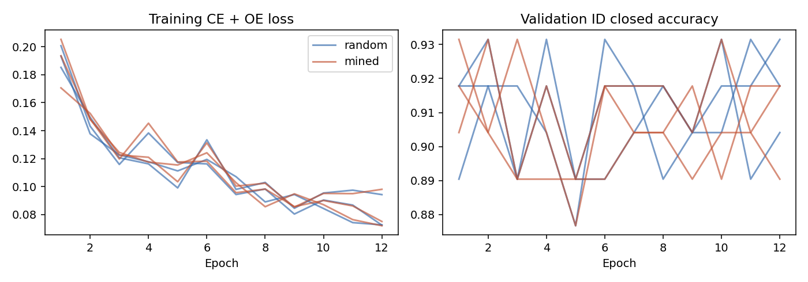
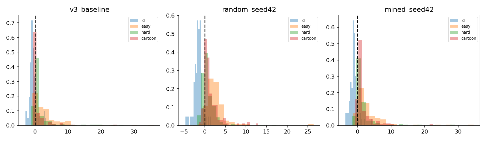
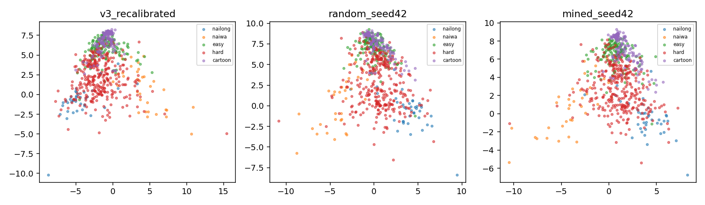

# V4 Phase 2：Random Cartoon OE 与 Hard Negative Mining

**实际结论：Mined真实卡通FAR 7.66%，Random 9.01%，差异缺乏跨作品／种子的可靠证据；两组Emoji FAR均退化。保留V3，未导出或部署新候选。** [完整结论与14问](../../results/v4_phase2/conclusion.md)。

本轮保留 V3 自定义 CNN、256D embedding、两类 head 和生产 `web/`。不更换 backbone，不加入 SupCon/Triplet，不把 Other 改回普通第三类。本实验回答：在固定卡通池和同等继续训练预算下，按真实 OOD 接受边际挖掘负样本，是否优于随机选样。

## 数据与审核

真实下载 6 部带 CC-BY 许可记录的 Blender 动画，总计提取 1398 帧，感知去重后 1219 张联系表候选均经过助手视觉查看；保留 676 张。其中训练候选390、验证138、新最终测试148。没有独立外部人工复核，不能称为人工金标准。

| 角色 / 来源集合 | 图片数 | 用途 |
|---|---:|---|
| Big Buck Bunny：兔子、啮齿动物、鸟 | 157 | candidate training |
| Caminandes Llamigos：羊驼、企鹅 | 83 | candidate training |
| Cosmos Laundromat：黑羊、红发人形、毛虫 | 150 | candidate training |
| Sintel：人物与幼龙／成年龙 | 138 | validation only |
| Sprite Fright：人形、绿色圆润蘑菇角色 | 114 | final test only |
| Wing It：橙色圆润角色、猫状工程师 | 34 | final test only |

新 final 的粗类型为83张 stylized humanoid、31张 green round mushroom、34张 orange/catlike science-fiction character。`anthropomorphic_sheep` 是 Cosmos 来源粗标签，该150张并非全部只有羊；具体审核范围也包含人形。

整部电影及全部 cast 只归属一个 split，比仅按文件哈希或时间随机划分更严格。新测试没有参与训练、挖掘、checkpoint 选择或阈值校准；旧321张 Emoji 的成员与文件均不变。新数据相互及与2074张现有项目图片做像素哈希、64bit DCT pHash和RGB缩略图比较，并用已知电影角色／来源隔离补强。一对暗图被标记，完整图复核后确认不同，并在冻结前剔除角色证据不足的 Sprite133。最终没有未解决的跨 split 标记。不能保证感知哈希发现所有任意裁剪，但不同作品／角色和视觉查看提供额外约束。

原始照片没有扩容，新池不含 Emoji、噪声或AI生成图片。作品截图有大量相关帧，676不是676个独立身份。训练只有三组电影 cast，新 final 只有两组。缺少卡通青蛙、黄色恐龙、真实玩偶和多样2D表情包；所有作品都来自 Blender 生态，仍可能学到背景、压缩、照明等来源特征。保留画面没有检测到同时覆盖顶部／底部的近黑边，输入统一为128×128 RGB float32/255。

完整成员、来源许可、视频SHA、帧时间、图片SHA、像素SHA和pHash见 [cartoon_manifest.json](../../data/v4_phase2/cartoon_manifest.json)。下载视频和单帧不提交；[SOURCES.md](SOURCES.md) 提供所有署名及许可链接。[visual_review.json](visual_review.json)、[identity_review.json](../../results/v4_phase2/identity_review.json)、[data_audit.json](../../results/v4_phase2/data_audit.json) 保留审核证据。

## V3 错误及挖掘

历史 Emoji 测试52/321误接受。人形／幻想31/61，动物9/122，黄色表情12/138。冻结 OR 规则下，Energy 独自拦149，距离独自拦19，两者共同拦101，因此 Energy 是主要有效信号，距离有补充价值。ID误拒5/73，距离独有3、Energy独有1、共同1；三个闭集分类错误均被放行。误拒 ID 视觉上涉及文字、多角色、服装／拍摄形态和低清屏摄，属于覆盖不足的诊断假设，不能据此认定因果。历史测试图只用于诊断，没有复制进新数据。

只对390张训练候选加载冻结 V3 推理，真实误接受149张：BBB9/157、Caminandes27/83、Cosmos113/150。记录logits、softmax、Energy、Mahalanobis及实际组合规则。

`acceptance_margin = -ood_score`；V3 OR 对应两个归一化接受边际的最小值，大于等于0为放行。没有用二类softmax排序替代OOD规则。

每来源40张、总120张，Random与Mined共享来源配额及最小2秒时间间隔。随机组采用均匀随机优先级和可行性约束，不声称在所有受约束子集上均匀采样。Mined先优先深度误接受，再补边界附近样本。起初协议计划150张，但视觉过滤后的最小来源最多只有47张满足间隔约束，在任何新模型评分前通过 [data_protocol_addendum.json](data_protocol_addendum.json) 统一降低到40/来源，保留原始协议以便审计。

Random：48张原V3误接受、72张拒绝；Mined：61张误接受、59张边界侧拒绝；重叠46张。平均接受边际Random −0.595、Mined +0.081。最深的困难样本包括羊驼／企鹅场景、Cosmos红发人形和黑羊，仍限于少数身份。见 [mining.json](../../results/v4_phase2/mining.json)、[mining.csv](../../results/v4_phase2/mining.csv) 和 [mined_deepest_review.jpg](../../results/v4_phase2/mined_deepest_review.jpg)。选样列表在三个训练种子间固定，未测量“重新随机选择另一份负样本清单”的波动。

## 公平控制与校准

- A：生产 V3 权重、原OOD参数完全冻结。
- A_recalibrated：相同 V3 权重，仅按新共享validation重拟合 detector，用于区分校准变化与训练收益；不改生产。
- B：V3 + Random Cartoon OE，种子42/43/44。
- C：V3 + Mined Cartoon OE，种子42/43/44。

B/C 都从SHA `a53df59b…0a0e5f7` 的当前 V3 出发。相同345张ID、600张旧Easy OE、143张旧Hard OE，额外各120张卡通负样本。每epoch345次ID与345次OE抽样；OE概率质量：旧Easy25%、旧Hard25%、新Cartoon50%。配对种子使用相同抽样索引／augmentation随机流。AdamW lr1e-4、wd1e-4、ID/OE batch各32、loss=`CE +0.1*energy_margin_loss`，margin来自初始ID train energy90%分位，固定gap2。增强沿用flip、rotation8、小幅ColorJitter。没有更换网络／投影／分类head。

六次训练均完整12epoch、132更新；不因early stopping改变预算。按同一validation规则保存best checkpoint，最终最佳epoch可以不同：快速raw距离+T1 Energy OR、各99% ID分位、ID TAR至少95%且闭集accuracy不低于初始3pp，优先降低最差验证域FAR，再平均FAR、正确ID保留率。

每个模型只用345张ID train的embedding重拟合类中心与共享LedoitWolf covariance。共同validation为73 ID +150 Easy +70旧Hard +138新卡通，共431张。比较raw/L2、T=.5/1/2/5、距离、Energy、OR/AND，约束validation ID TAR≥95%，最小化Easy／旧Hard／新Cartoon最差FAR，再 pooled FAR 和正确ID保留。所有六组权重及阈值hash写入 [evaluation_lock.json](../../results/v4_phase2/evaluation_lock.json) 后，才一次性对八个系统执行相同最终测试。

测试为ID73、Easy150、Emoji321、新Cartoon148，共692张。模型不确定性报告三种子样本SD；测试抽样不确定性另用5000次配对group bootstrap：Emoji按Unicode身份，新Cartoon按整部电影／cast。新final只有2个组，区间仅为当前作品条件下的描述，不足以建立跨角色／画风泛化。AUPR以OOD为正，受OOD占比影响；FPR@95TPR是测试ROC的诊断统计，不用于重新选择生产阈值。ID单张占1.37pp，不能过度解释小变化。

## 实际结果

完整结果见 [comparison.md](../../results/v4_phase2/comparison.md)、[comparison.csv](../../results/v4_phase2/comparison.csv)、[source_breakdown.csv](../../results/v4_phase2/source_breakdown.csv)；每次训练的history/config、逐图prediction、每类recall／误拒／误分类计数、AUROC/AUPR/FPR95均单独保留。[uncertainty.json](../../results/v4_phase2/uncertainty.json) 分开报告种子差异和身份／作品组抽样差异。







PCA只拟合ID train并投影固定test，seed42预先指定作图，不能用漂亮二维图代替FAR证据。结论和是否替换生产见 [conclusion.md](../../results/v4_phase2/conclusion.md)。

## 复现

项目根目录。Python/库/ffmpeg实际版本记录在 [environment.json](../../results/v4_phase2/environment.json)。需要命令行`ffmpeg`，相同版本有助于复现精确JPEG哈希；下载的视频约625MiB，另需帧、缓存与原数据空间。

```bash
python -m venv .venv
source .venv/bin/activate
python -m pip install torch==2.14.1 torchvision==0.29.1 --index-url https://download.pytorch.org/whl/cpu
python -m pip install -r requirements.txt
python -m pip install -r requirements-dev.txt
# 若原数据尚未恢复：
git clone https://github.com/CristinXie/NaiwaOrNailong-dataset.git data/NaiwaOrNailong-dataset
git -C data/NaiwaOrNailong-dataset checkout 900b0419d9c0cfb5ef3c12938a2cbf0ae5eb2abb
python training/prepare_other_dataset.py
python training/prepare_hard_ood.py
python training/prepare_hard_ood_benchmark.py
# 当前 V3 checkpoint 已随项目保留；这里不重新训练V3/MobileNet。
export OPENBLAS_NUM_THREADS=2 OMP_NUM_THREADS=2 MKL_NUM_THREADS=2
python training/prepare_cartoon_negatives.py
python training/prepare_cartoon_negatives.py --lock
python training/v4/mine_hard_negatives.py
# 首次实验、evaluation lock尚不存在时可运行预检：
python scripts/verify_v4_phase2_preflight.py
python training/run_v4_phase2.py --stage all
# 已有完整训练结果，只重算统一评估：
# python training/run_v4_phase2.py --stage evaluate
python scripts/verify_v4_phase2_browser.py
python scripts/verify_v4_phase2.py
```

浏览器回归优先使用`/usr/bin/chromium`；其他机器可先运行`python -m playwright install chromium`，再运行`python scripts/verify_v4_phase2_browser.py --chromium ''`。开发依赖为Playwright。浏览器检查实际ONNX WASM与Python ORT logits/embedding/OOD分数，仅针对未改变的生产V3，不宣称新候选已导出或部署。所有模型/参数不满足可信提升门槛时不导出候选，不替换Cloudflare Pages文件。

新网络/图片/权重若发生变化，冻结检查会报错；应建立新的实验版本，不能覆盖本轮manifest或evaluation lock后再调参。未来`data/false_positive/`和`data/hard_negative/`仍可作为新实验训练反馈，本轮val/test若被复制进去会被loader拒绝，后续新增数据仍需重做感知去重和身份审核。

## 独立版本文件

```text
experiments/v4_phase2/          # 原协议、训练前数据补充协议、审核规则、固定B/C选样
data/v4_phase2/cartoon_manifest.json  # 固定成员与可审计来源
training/prepare_cartoon_negatives.py
training/v4/mine_hard_negatives.py
training/v4_phase2/{pipeline,guards,report}.py
training/run_v4_phase2.py
checkpoints/v4_phase2/*.pth     # 六次真实OE继续训练best checkpoint
results/v4_phase2/             # freeze、calibration、metrics、逐图CSV、图、最终结论
scripts/verify_v4_phase2*.py    # 预检、隔离／预算／输出、生产浏览器回归
web/                          # 原V3，所有文件SHA不变
```
